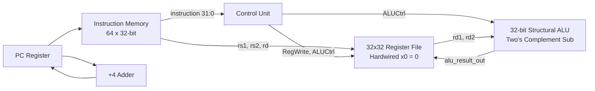

# Vector-V.1 — RV32I Single-Cycle RISC-V Processor


A modular, structural **32-bit RISC-V (RV32I)** processor designed from scratch in **Verilog HDL** using gate-level and structural RTL building blocks, verified in **ModelSim** with a self-checking scoreboard testbench.

---
[](https://mohd118258-beep.github.io/Vector-V.1/index.html)

## Microarchitecture Overview

Every datapath and control component is isolated into an independent, synthesizable Verilog module and wired structurally inside `Riscv_top`:



---

## Repository Structure

```text
Vector-V.1/
├── assets/
│   └── 1_v1_stress_test_waveform.png   # ModelSim self-checking simulation waveform
├── Riscv_top.v                         # Top-level structural processor wrapper
├── fetch_unit.v                        # Program Counter & PC+4 fetch logic
├── instruction_memory.v                # 64-word ROM with word-aligned addressing [7:2]
├── control_unit.v                      # Combinational opcode & funct7[30] decoder
├── Datapath_32bit.v                    # Structural interconnect for Register File & ALU
├── register_file.v                     # 32x32 register bank with x0 write protection
├── alu_32bit.v                         # 32-bit ripple-carry ALU generated from 1-bit slices
├── alu_1bit.v                          # 1-bit ALU slice with XOR subtraction inversion
├── Full_adder.v                        # Gate-level 1-bit full adder
├── mux2to1.v                           # 2-to-1 multiplexer primitive
└── riscv_tb.v                          # Self-checking stress testbench (err_count scoreboard)
```

---

## Verification & Stress Test Benchmarks

Verified in **ModelSim - Intel FPGA Edition** across 6 consecutive clock cycles (`60 ps` simulation window) with **`err_count = 0`**:

| Cycle / PC | Instruction | Operation | Corner Case Tested | Expected | Actual | Status |
| :--- | :--- | :--- | :--- | :---: | :---: | :---: |
| `0x00` | `add x3, x1, x2` | `10 + 4` | Basic R-type addition & register writeback | `14` | `14` | PASS |
| `0x04` | `sub x4, x1, x2` | `10 - 4` | Two's complement subtraction (`~B + 1`) | `6` | `6` | PASS |
| `0x08` | `add x0, x1, x2` | `10 + 4 -> x0` | Attempted overwrite of hardwired zero register `x0` | `14` *(ALU)* | `14` | PASS |
| `0x0C` | `sub x5, x2, x3` | `4 - 14` | Back-to-back RAW dependency & signed negative result | `-10` | `-10` | PASS |
| `0x10` | `add x6, x0, x2` | `0 + 4` | Confirms `x0` stayed `0` after overwrite attempt | `4` | `4` | PASS |
| `0x14` | `nop` (`addi x0,x0,0`) | `0 + 0` | Clean idle bus state (`X`-free waveform) | `0` | `0` | PASS |

### Simulation Waveform


---

## How to Run in ModelSim

1. Open **ModelSim** and compile all `.v` files in the root directory.
2. Start simulation on the top testbench module (`work.riscv_tb`).
3. Run the following commands in the ModelSim **Transcript**:

```tcl
add wave -radix unsigned /riscv_tb/pc_out
add wave -radix hexadecimal /riscv_tb/instruction_out
add wave -radix decimal /riscv_tb/alu_result_out
add wave -radix unsigned /riscv_tb/err_count
restart -f
run -all
```

---

## Roadmap — Vector-V.2
* [ ] **RV64I 64-Bit Expansion**: Widen datapath, register bank, and ALU from 32-bit to 64-bit (`[63:0]`).
* [ ] **Base ISA Completion**: Add 64-bit Sign-Extending Immediate Generator (`imm_gen`), Data Memory (`ld`/`sd`), and Branch unit (`beq`).
* [ ] **5-Stage Pipelined Architecture**: Implement `IF/ID`, `ID/EX`, `EX/MEM`, and `MEM/WB` pipeline registers with Data Forwarding and Hazard Detection (Stall/Flush).
* [ ] **Assembly Program Execution**: Run multi-loop RISC-V assembly programs assembled via RARS / GNU Toolchain.